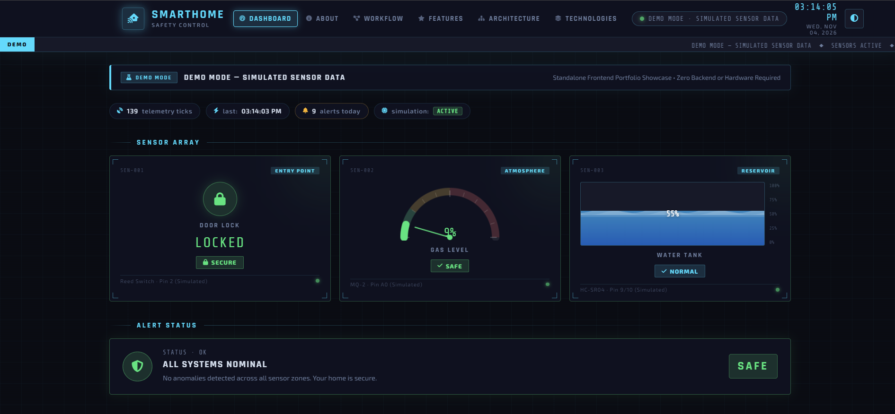
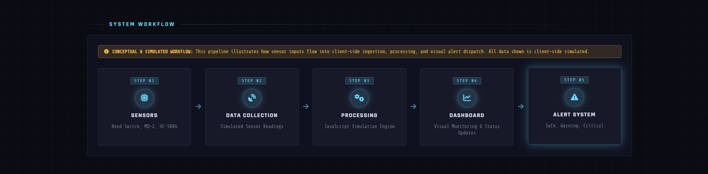
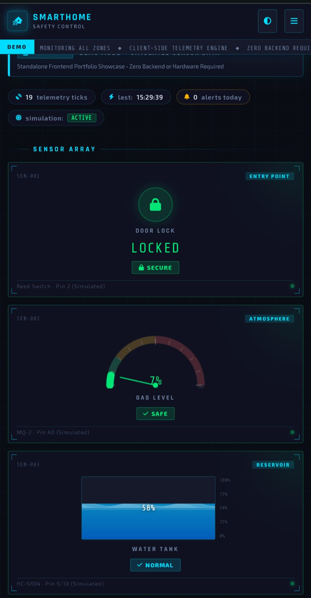

# Smart Home Safety Control Panel — Standalone Portfolio Demo

An interactive, client-side IoT dashboard simulation showcasing real-time telemetry, responsive data visualization, and safety monitoring.

> **DEMO MODE — SIMULATED SENSOR DATA**  
> This standalone portfolio build runs entirely in the browser with zero backend, server, or hardware dependencies. All telemetry and sensor signals are generated by an integrated client-side simulation engine.

---

## 📸 Dashboard Preview



*Figure 1: Smart Home Safety Control Panel running in interactive Demo Mode.*

> **Simulation Notice:** All sensor readings, alert triggers, gauges, water level animations, and hardware interactions shown in this dashboard are simulated entirely client-side using JavaScript. No physical Arduino microcontroller, physical sensors, or backend servers are connected.

---

## 🔄 System Workflow



*Figure 2: Conceptual workflow illustrating sensor input, simulated data collection, processing, dashboard monitoring, and alert generation.*

---

## 📱 Mobile Responsive Preview



*Figure 3: Smart Home Safety System dashboard displayed on a mobile device, demonstrating its responsive layout.*

---

## 🧭 Project Navigation & Overview

The application features smooth scrolling navigation across dedicated portfolio sections:
- **Dashboard**: Live telemetry meters, radial gauge, animated water reservoir, alert matrix, manual override, and activity logs.
- **About the Project**: Executive summary and sensor capability breakdowns for recruiters and interviewers.
- **System Workflow**: 5-step horizontal/vertical data flow pipeline from sensor inputs to triage alerts.
- **Key Features**: Complete catalog of 11 interactive and architectural dashboard capabilities.
- **Project Architecture**: Visual subsystem hierarchy and decoupled client-side simulation design.
- **Technology Stack**: Direct breakdown of implemented frontend software technologies alongside original prototype hardware specifications.

---

## 🚀 Live Demo & How to Run

Because this project is 100% frontend-only, you can run it immediately without installing Python, Flask, MySQL, Node.js, or any external drivers.

### Option 1: Direct File Launch (No Setup)
Simply double-click `index.html` in your file explorer, or right-click `index.html` and choose **Open With > Google Chrome** (or any modern browser: Firefox, Edge, Safari).

### Option 2: Local HTTP Server (Optional)
If you prefer running via a local web server:

- **Python 3**:
  ```bash
  python -m http.server 8000
  ```
  Then open `http://localhost:8000` in your browser.

- **Node.js (`npx serve` or `http-server`)**:
  ```bash
  npx serve .
  ```
  or
  ```bash
  npx http-server . -p 8000
  ```

- **VS Code Live Server**:
  Right-click `index.html` and select **"Open with Live Server"**.

---

## 📁 Project Structure

```
Smart-Home-Portfolio/
├── index.html          # Semantic HTML5 dashboard layout, navigation, and portfolio sections
├── css/
│   └── style.css       # Sci-Fi/Cyberpunk HUD theme, animations, dark/light modes, & responsive rules
├── js/
│   └── script.js       # Sensor telemetry simulation, React micro-roots, Canvas gauge, safe DOM log
├── screenshots/
│   ├── dashboard.png   # Dashboard UI preview screenshot
│   ├── workflow.png    # System workflow architecture diagram screenshot
│   └── mobile.png      # Mobile responsive viewport screenshot
└── README.md           # Comprehensive project documentation and portfolio showcase guide
```

---

## ⚡ 11 Core Key Features

1. **Real-Time-Style Simulated Sensor Monitoring**: Continuous simulated sensor stream updating telemetry synchronously without server latency.
2. **Automatic Sensor Value Fluctuations**: Realistic sensor drift, ambient noise modeling, and natural dissipation cycles.
3. **Interactive Manual Override Controls**: Direct testing of Door, Gas, and Water states with an intelligent 15-second grace hold period.
4. **Dynamic Tri-Tier Alerts**: Automated threat triage into Safe (green), Warning (amber), and Danger (pulsing red) states.
5. **Animated Gas-Level Gauge**: Custom HTML5 Canvas radial gauge with dynamic color zones, tick marks, and needle physics.
6. **Animated Water Tank Visualization**: Fluid level visualization featuring SVG dual-wave motion and reactive overflow warning thresholds.
7. **Live Digital Clock**: Synchronized digital clock and calendar readout formatted in futuristic Share Tech Mono typography.
8. **Dark/Light Theme Switching**: Seamless one-click theme switcher driven by CSS custom properties with automatic Canvas redraw.
9. **Activity Log with Local Persistence**: Safe DOM event recording with severity tags, individual/bulk deletion, and `localStorage` persistence.
10. **Pause and Resume Simulation**: Interactive control allowing reviewers to freeze the telemetry stream to inspect static states.
11. **Responsive Dashboard Interface**: Fully adaptive Cyberpunk layout optimized for 4K displays, laptops, tablets, and mobile devices.

---

## 🔄 System Workflow Pipeline

```
[01. SENSORS] (Reed Switch, MQ-2, HC-SR04)
      │
      ▼
[02. DATA COLLECTION] (Simulated Sensor Readings)
      │
      ▼
[03. PROCESSING] (JavaScript Simulation Engine)
      │
      ▼
[04. DASHBOARD] (Visual Monitoring & Status Updates)
      │
      ▼
[05. ALERT SYSTEM] (Safe, Warning, Critical)
```
*Note: Conceptual & simulated pipeline. All telemetry is generated client-side.*

---

## 🏗️ Project Architecture

```
USER INTERACTION
       │
       ▼
SMART HOME DASHBOARD UI
       │
       ├───────────────────┬───────────────────┬───────────────────┐
       ▼                   ▼                   ▼                   ▼
  Door Security       Gas Monitoring      Water Monitoring     Alert & Activity
     Module              Module              Module              Module
       │                   │                   │                   │
       └───────────────────┼───────────────────┴───────────────────┘
                           │
                           ▼
             CLIENT-SIDE SIMULATION ENGINE
       (Decoupled JavaScript Telemetry & State Management)
```

---

## 🛠️ Technology Stack Breakdown

### Implemented Software Stack
- **HTML5**: Semantic dashboard structure, accessibility containers, and component mounting targets.
- **CSS3**: Cyberpunk styling, CSS custom variables, keyframe wave animations, and mobile media queries.
- **JavaScript (ES6+)**: Centralized sensor simulation engine, telemetry state management, and DOM event listeners.
- **React 18 CDN**: Micro-root component rendering for high-frequency telemetry text nodes without full-DOM re-renders.
- **HTML5 Canvas API**: Custom radial gas gauge rendering with arc geometry, colored zones, and needle drawing.
- **LocalStorage API**: Client-side persistence for dark/light theme preferences and historical safety event logs.

### Prototype Hardware Specification (Simulated Context)
> *The following specifications represent the original physical prototype design. In this portfolio demo, all telemetry is simulated client-side. No physical hardware is currently connected.*
- **Arduino Uno**: Microcontroller unit for pin polling and serial communication (Original prototype specification).
- **Magnetic Reed Switch**: Contact sensor for door closure and physical entry-point monitoring (Original prototype specification).
- **MQ-2 Gas Sensor**: Analog atmospheric sensor for gas and smoke detection (Original prototype specification).
- **HC-SR04 Ultrasonic Sensor**: Time-of-flight sensor for water reservoir height measurement (Original prototype specification).

---

## 📄 License & Attribution

Designed & developed for interactive software engineering portfolio demonstration.  
© 2026 Smart Home Safety System. All rights reserved.
